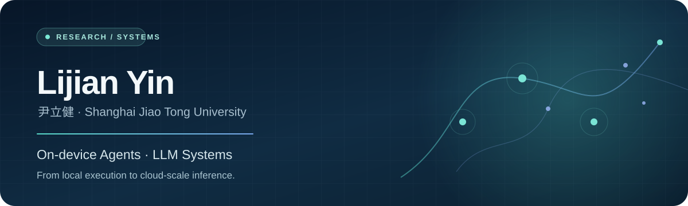
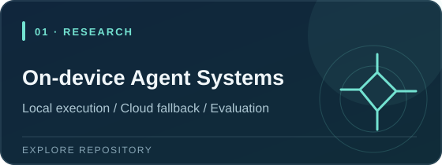
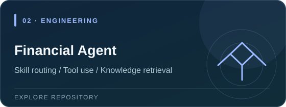

[Research & projects](#selected-work)  ·  [Personal website](https://jolyndra.github.io/)  ·  [Email](mailto:jolyndra@sjtu.edu.cn)

---

I build and study agent systems that work across **local devices and cloud models**. My current focus is on reliable tool use, model routing, KV cache, and the trade-offs between task success, latency, and inference cost.

### Selected work

<table>
<tr>
<td width="50%" valign="top">

  
Local execution, cloud fallback, tool retrieval, and predictive prewarming. Evaluating agent behavior and system cost on reproducible benchmarks.
</td>
<td width="50%" valign="top">

  
A Skill Agent built on the OpenAI Agents SDK, with skill routing, tool execution, and traceable financial knowledge retrieval.
</td>
</tr>
</table>

**Anaxa** · Undergraduate thesis  
A communication library prototype for Attention–Expert disaggregated inference, exploring low-latency RDMA data paths and topology-aware routing.

### Research interests

`On-device agents` &nbsp; `Model routing` &nbsp; `KV cache` &nbsp; `LLM serving` &nbsp; `RDMA communication`

<strong>More about me</strong>

 

I am pursuing an M.S. in Computer Science and Big Data Technology at **Shanghai Jiao Tong University**. I received my B.S. in Software Engineering from **Beihang University**.

I enjoy turning research questions into measurable systems: building a baseline, tracing failures, and testing whether an optimization helps the full task rather than only a microbenchmark.

---

Open to research conversations, technical collaboration, and internships in agent systems and LLM infrastructure.

**[Get in touch](mailto:jolyndra@sjtu.edu.cn)** · **[Website](https://jolyndra.github.io/)**

